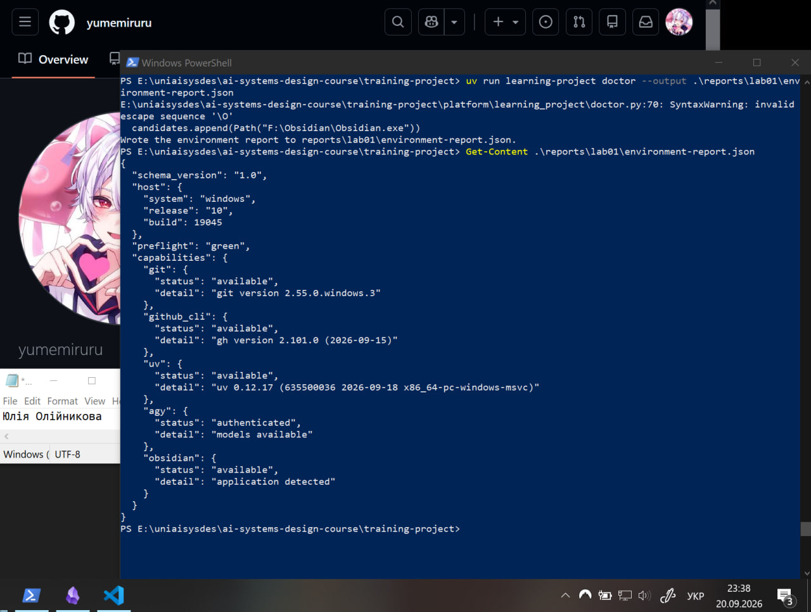
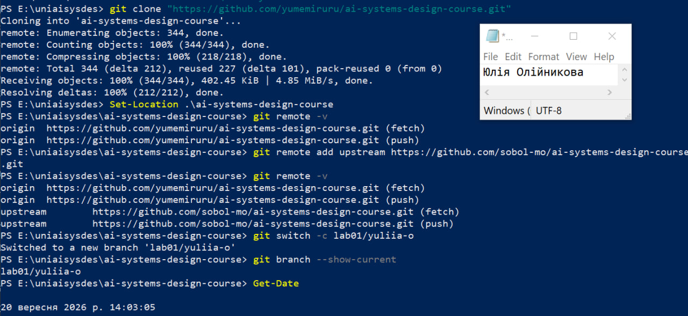
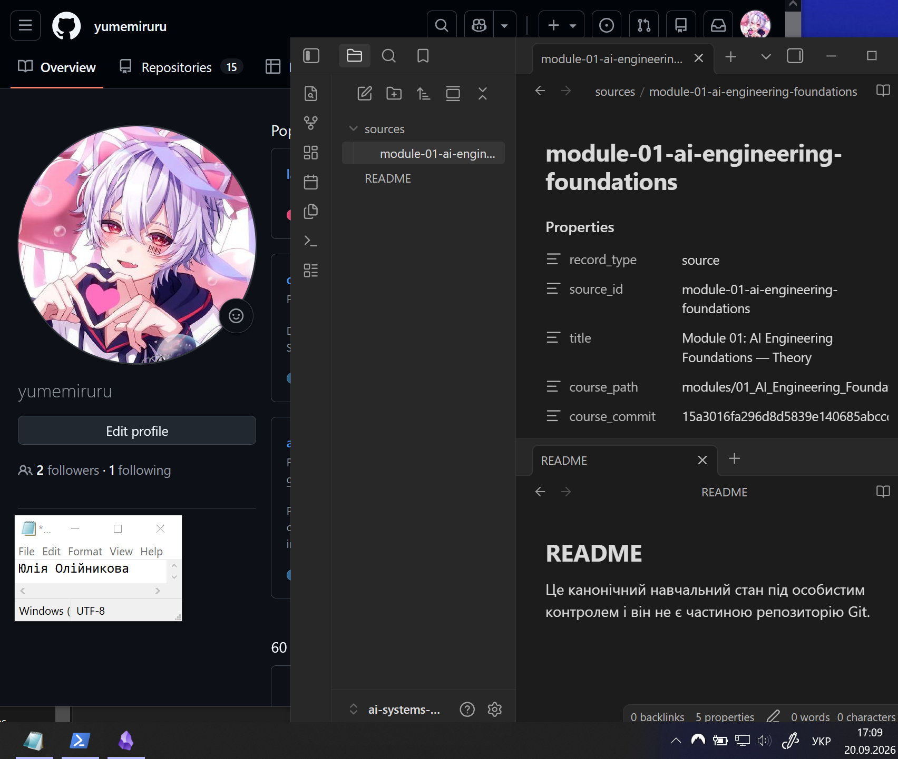
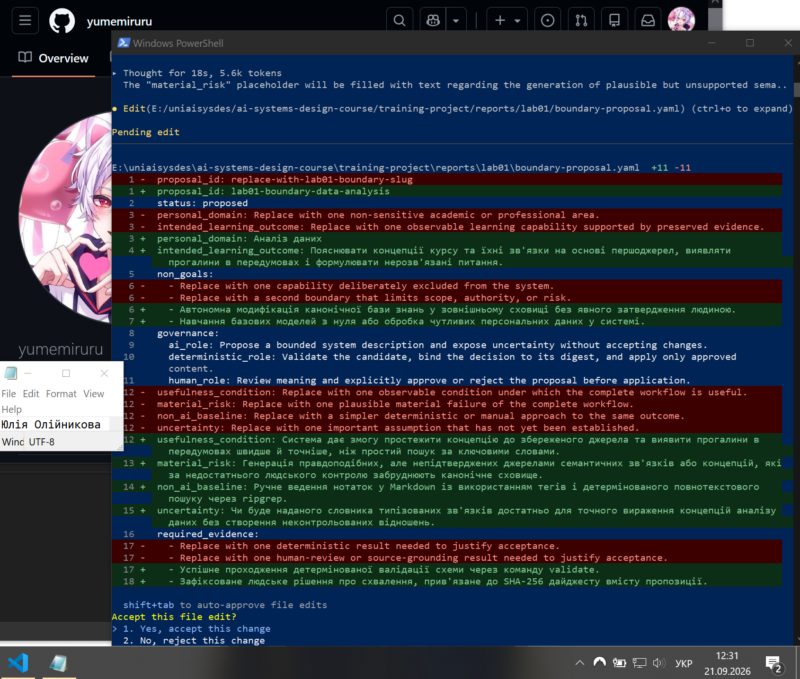
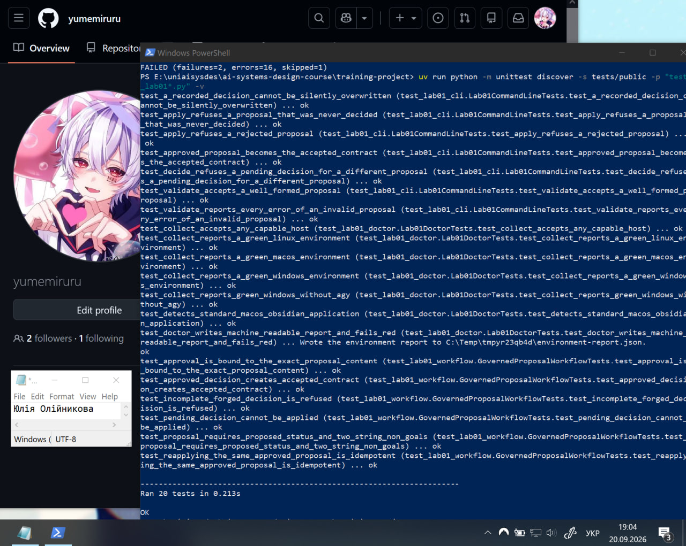
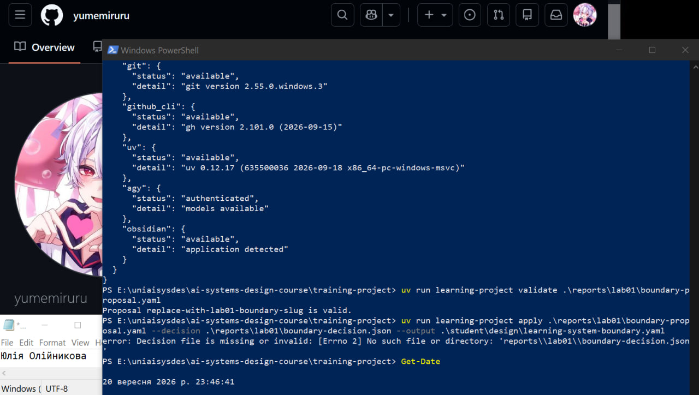
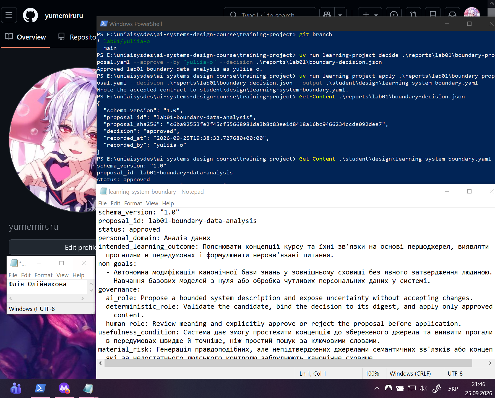

# Лабораторна робота 01

Заповнити кожен розділ власними словами українською мовою. Не вилучати заголовки. У потрібних розділах додати знімки екрана відносними шляхами Markdown до файлів у `screenshots/` із точними іменами, названими в лабораторній роботі. Підпис ставити наступним рядком після зображення.

## Ідентифікація подання

- URL форку: https://github.com/yumemiruru/ai-systems-design-course
- Назва гілки: lab01/yuliia-o
- Повний хеш коміту: d3401b3f5f8946b1015c11e420da22affb1b80f5

## Середовище

Під час перевірки можливостей робочої станції проблем не виникло, усі необхідні ресурси відображені як доступні.

Рисунок — `02-workstation-capabilities.png`

## Власність репозиторію

Віддалений репозиторій origin є форком проєкту на GitHub, який належить студенту, і слугує єдиним цільовим репозиторієм для надсилання внесених змін. Натомість upstream — це публічний репозиторій викладача, призначений виключно для отримання нових публікацій та оновлень курсу. Будь-яке надсилання змін до upstream виключене, а оновлення його каталогів відбувається лише через отримання нових даних. Для безпосереднього виконання завдань була створена відокремлена особиста гілка lab01/yuliia-o, оскільки фіксувати результати роботи безпосередньо в головній гілці main заборонено.

Рисунок — `01-git-remotes.png`

## Зовнішнє сховище Markdown-файлів

Поза межами клону Git було створено зовнішнє сховище Markdown-файлів із нейтральним файлом README.md. У цьому сховищі було зареєстровано перше джерело курсу (теорію модуля 01), для чого у YAML-передмові відповідного файлу було зафіксовано точний 40-символьний хеш поточного коміту та шлях до файлу курсу. Захист від втрати поза пристроєм не був налаштований.

Рисунок — `05-external-vault.png`

## Шлях пропонувача

Для генерації кандидатної пропозиції було використано інтерактивний сеанс ШІ-агента Antigravity CLI (команда agy). Агент успішно отримав доступ до локальних файлів, проаналізував надані контракти та запропонував коректні зміни до файлу boundary-proposal.yaml у межах своїх обмежених повноважень. Потреби у використанні ручного запасного шляху не виникло, оскільки агент відпрацював без помилок доступу, квоти чи служби.

Рисунок — `04-proposer-session.png`

## Семантичний розгляд

Відповідь і висновок для кожного з дев’яти запитань кроку 8 були записані **до** запуску `decide`.

1. Так. Агент чітко зафіксував у поясненні, що сфера «Аналіз даних» є лише «можливим пізнішим обмеженим розширенням» і не змінює сутності системи як навчального сховища знань. У файлі пропозиції це відображено полем personal_domain: Аналіз даних.
2. Так. Результат сформульовано як спостережувану здатність студента: «Пояснювати концепції курсу та їхні зв'язки на основі першоджерел, виявляти прогалини... і формулювати нерозв'язані питання». Тут немає жодної згадки про просто «використовувати ШІ».
3. Так. Зазначені нецілі прямо забороняють «автономну модифікацію канонічної бази знань... без явного затвердження людиною» та «навчання базових моделей з нуля або обробку чутливих персональних даних». Крім того, у текстовому поясненні агент наголосив на виключенні рішень із високими наслідками (медичних, юридичних, фінансових).
4. Так. Повноваження жорстко розмежовані: ai_role обмежується пропонуванням без ухвалення змін, deterministic_role відповідає за перевірку, прив'язку рішення до дайджесту та застосування, а human_role залишає за людиною розгляд змісту та явне затвердження/відхилення.
5. Так. Умова «простежити концепцію до збереженого джерела... швидше й точніше, ніж простий пошук за ключовими словами» є практичною і її можна легко виміряти на практиці, порівнявши час і якість результату.
6. Так. Ризик полягає у тому, що система може вигадувати правдоподібні, але не існуючі в джерелах семантичні зв'язки. Це класичний приклад мовчазної семантичної відмови: якщо людина-рецензент втратить пильність і затвердить таку пропозицію, помилкові дані назавжди забруднять канонічне сховище знань.
7. Так. «Ручне ведення нотаток у Markdown із використанням тегів і детермінованого повнотекстового пошуку через ripgrep» — це абсолютно реалістичний, дешевший і надійніший підхід, який закриває базову потребу в зберіганні знань.
8. Так, цей пункт повністю відповідає вимогам, оскільки поєднує як машинний, так і людський контроль. Він вимагає двох доказів: технічного (успішне проходження автоматичної перевірки структури через validate) та процедурного (зафіксоване усвідомлене рішення людини, яке криптографічно прив’язується до незмінного SHA-256 дайджесту цієї пропозиції).
9. Так. Питання «чи буде наданого словника типізованих зв'язків достатньо для точного вираження концепцій аналізу даних без створення неконтрольованих відношень» є чудовим архітектурним сумнівом, який неможливо вирішити до етапу реального використання.

## Розподіл повноважень

У звичайній системі ШІ формує вільно згенеровані виходи, які можуть містити непідтверджену або хибну інформацію (галюцинації). Обмеження повноважень агента виключно пропонуванням змін гарантує, що жодна помилка моделі не призведе до автономної модифікації канонічної бази знань без семантичного розгляду та затвердження людиною. Оскільки під час роботи агент Antigravity CLI успішно впорався із завданням без технічних збоїв чи обмежень квот, потреба використовувати ручний запасний шлях не виникла. 

## Корисність і базова лінія без ШІ

Базова лінія без ШІ (ручне ведення нотаток у Markdown із детермінованим повнотекстовим пошуком через ripgrep) вже ефективно та дешево вирішує завдання надійного збереження даних та пошуку точних ключових слів. Проте застосування ШІ стає корисним завдяки його здатності синтезувати інформацію: він допомагає простежувати концепції до джерел, пояснювати приховані семантичні зв'язки та виявляти прогалини в передумовах набагато швидше й точніше, ніж простий пошук за ключовими словами. 

## Особиста предметна сфера як пізніше розширення

Вибрана сфера «Аналіз даних» є лише можливим пізнішим розширенням, оскільки система має залишатися універсальним інструментом для навчання, а не перетворюватися на спеціалізований прикладний застосунок. Це запобігає використанню системи для розв'язання непередбачених завдань або обробки чутливих даних.

## Проєктний компроміс

Головний проєктний компроміс у цій системі полягає у балансі між підвищеною корисністю та зростанням ризику мовчазних семантичних відмов. Додавання ШІ значно прискорює аналіз зв'язків між документами, але створює загрозу генерації правдоподібних, проте вигаданих концепцій, які можуть забруднити канонічне сховище.

## Детерміновані перевірки

У межах виконання роботи було успішно пройдено всі детерміновані публічні тести, що підтвердило коректність налаштування локального середовища. Спроба застосувати пропозицію (команда apply) до ухвалення рішення очікувано завершилася відмовою, що підтверджує надійність системних обмежень. Фінальний прийнятий контракт learning-system-boundary.yaml було успішно згенеровано системою лише після того, як людина явно зафіксувала своє затвердження командою decide. Успішне проходження автоматичної валідації схеми (validate) доводить виключно структурну коректність файлу: наявність обов'язкових полів, правильних типів даних та дозволених статусів. Проте детермінований інструмент не здатен оцінити смислове наповнення тексту, адекватність описаних ризиків, корисність результату чи логічність розподілу обов'язків. Саме тому структурно правильний файл може бути змістовно безглуздим, і для підтвердження якості проєкту завжди вимагається семантичний розгляд уповноваженим лицем.

Рисунок — `03-public-tests.png`

Рисунок — `06-premature-apply-refused.png`

Рисунок — `07-accepted-contract.png`

## Відновлення

Відтворюване середовище проєкту є похідним станом, який не відстежується в Git, тому його можна легко відбудувати з нуля на будь-якому підтримуваному хості за допомогою наданих конфігурацій та команди uv sync. Артефакти проєкту (пропозиції, контракти, звіти), що належать студенту, надійно збережені в системі контролю версій, і їх можна повністю відновити шляхом клонування особистого форку (origin) з GitHub. Змінне канонічне сховище Markdown-файлів навмисно розташоване поза межами репозиторію Git, тому інструменти Git не можуть його відновити. Наразі сховище зберігається виключно локально на робочій станції і не має налаштованої копії поза пристроєм, що є зафіксованим обмеженням поточного стану системи.
