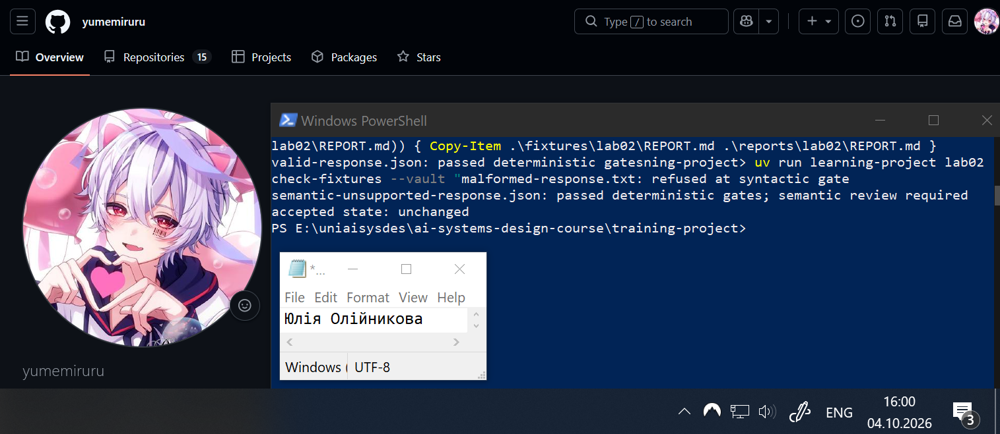
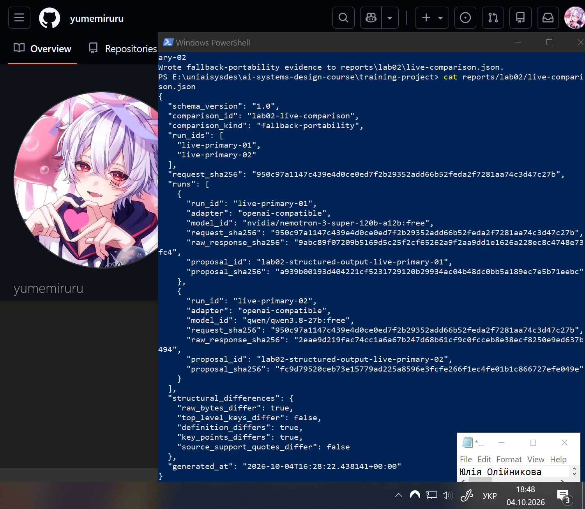
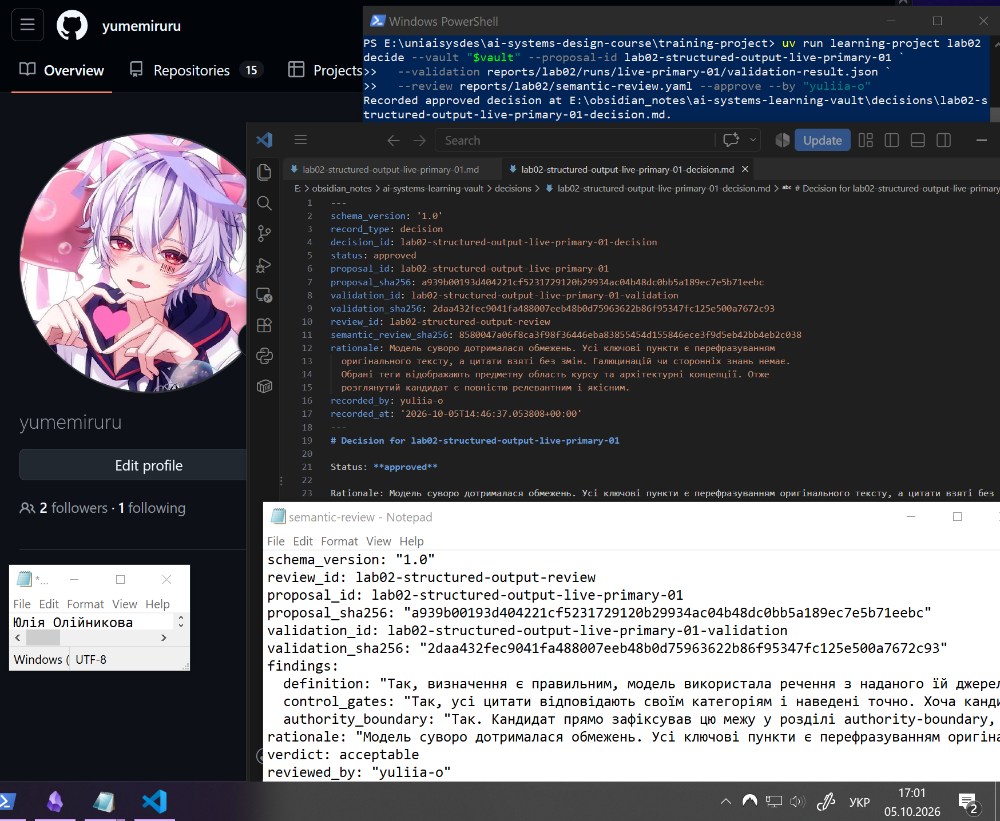
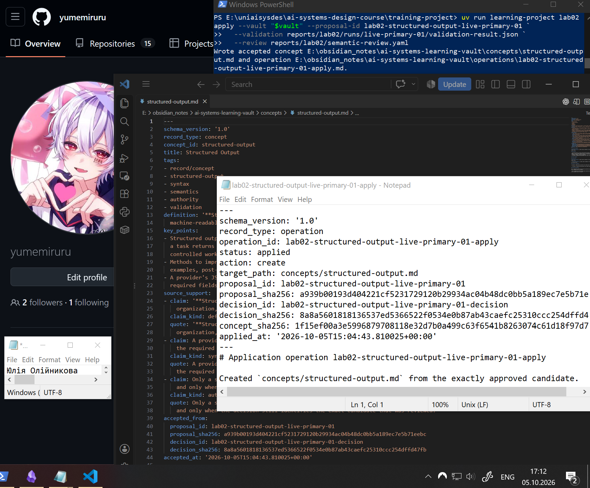
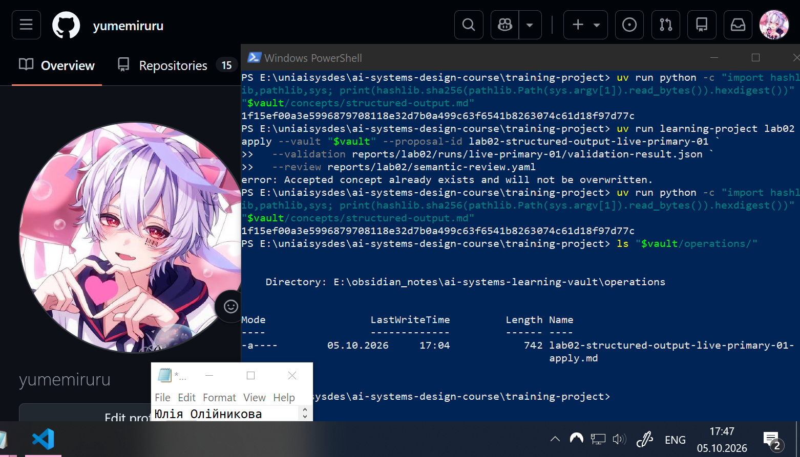
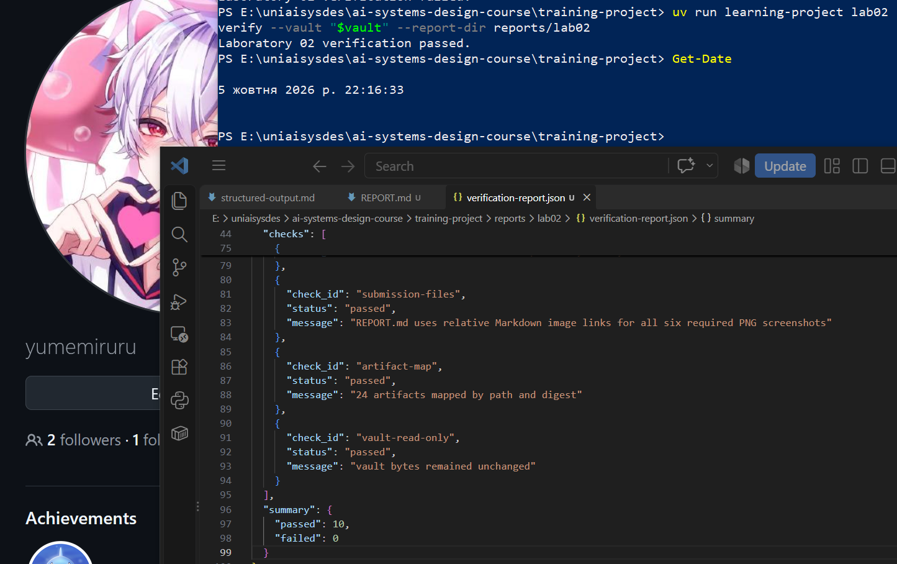

# Лабораторна робота 02

Заповнити кожен розділ власними словами українською мовою. Не вилучати заголовки. Описати перебіг роботи, виконані дії, спостережені результати та причини прийнятих рішень. Залишити наведені відносні шляхи до знімків екрана й підписи з точними іменами файлів. На кожному знімку мають бути видимі обліковий запис операційної системи або GitHub і системна дата; підпис не замінює цієї видимої ідентифікації.

## Ідентифікація подання

- URL форку: https://github.com/yumemiruru/ai-systems-design-course
- Назва особистої гілки: lab02/yuliia-o
- Повний хеш коміту зі свідченнями: d089e1665ea67bd70d0b0d0103ba2386c9c6b68f

## Початковий стан і реєстрація джерела

Роботу було розпочато із синхронізації опублікованого стану курсу. Було завантажено оновлення з upstream/main у локальну гілку main та створено особисту робочу гілку lab02/yuliia-o. Зовнішнє сховище Obsidian на початку роботи містило лише README.md та джерела з першої лабораторної роботи, файл цільового поняття concepts/structured-output.md був відсутній. Після цього був зареєстрований точний фрагмент джерела (підрозділ 1.3 з теорії модуля 02) за допомогою команди register-source.   

Зафіксований під час реєстрації course_commit є незмінним базовим станом джерела. Він фіксує точну версію оригінального тексту викладача на момент створення запиту. Це потрібно для того, щоб фінальний перевіряльник міг гарантувати, що кандидата було згенеровано на основі справжнього, незміненого тексту, і що оригінальні файли курсу не були відредаговані. 

## Детерміновані шлюзи

Під час тестування детермінованих шлюзів було оброблено три різні фікстури, що призвело до відповідних результатів валідації без жодної зміни прийнятого стану системи. Фікстуру з пошкодженою структурою malformed-response.txt було одразу відхилено на синтаксичному шлюзі. Натомість коректна відповідь valid-response.json успішно подолала всі детерміновані перевірки. Семантично непридатна фікстура semantic-unsupported-response.json також успішно пройшла детерміновані шлюзи, проте для неї було зафіксовано вимогу обов'язкового семантичного розгляду.

Успішне проходження синтаксичної перевірки та перевірки інваріантів не надає автоматичного семантичного схвалення, оскільки детерміноване програмне забезпечення здатне перевірити лише структуру документа. Програмна схема може підтвердити наявність необхідних полів та відповідність формату, але вона принципово не здатна довести, що вміст цих полів є точним, правдивим або підкріпленим доказами з джерела. 

Рисунок — `01-offline-gates.png`

## Живі запуски та порівняння

Під час виконання двох живих запусків для обох випадків було застосовано адаптер openai-compatible з OpenRouter. У першому запуску було використано модель nvidia/nemotron-3-super-120b-a12b:free, тоді як у другому запуску запит було оброблено моделлю qwen/qwen3.8-27b:free. Відповідно до зафіксованих метаданих, це порівняння класифікується як fallback-portability. Таке значення поля comparison_kind обґрунтовується використанням двох різних моделей для виконання ідентичного запиту, що підтверджується збігом значень request_sha256 для обох запусків. Аналіз структурних відмінностей між двома згенерованими кандидатами показав, що їхні ключі верхнього рівня та цитати на підтримку джерела є абсолютно однаковими. Проте було зафіксовано конкретні відмінності у згенерованому тексті: значення полів визначення та ключових пунктів відрізняються між двома пропозиціями, що також призвело до загальної відмінності на рівні сирих байтів.

Рисунок — `03-live-comparison.png`

## Семантична коректність і повноваження

Успішне проходження детермінованої перевірки та наявність схеми на боці постачальника не доводять семантичної коректності кандидата, оскільки програмне забезпечення здатне підтвердити лише структурну цілісність даних. Схема може гарантувати наявність необхідних полів, але вона не здатна оцінити, чи їхній вміст точно відображає оригінальне джерело. Повноваження приймати або відхиляти кандидата належать виключно уповноваженому рецензенту (людині), який несе відповідальність за аналіз змісту, перевірку доказів та фіксацію остаточного експертного рішення.

У цій архітектурі межі повноважень чітко розділені між усіма компонентами. Мовна модель має право лише генерувати пропозицію кандидата і позбавлена можливості створювати канонічні записи. Детермінований код виконує виключно читання та перевірку синтаксису пропозиції, не маючи повноважень схвалювати її чи змінювати базу знань. Своєю чергою, окрема операція застосування має право записувати прийнятий стан лише за умови наявності формально затвердженого рішення, яке криптографічно ідентифікує саме того кандидата, якого було розглянуто рецензентом.

## Семантичний розгляд і рішення

Під час семантичного розгляду було підтверджено, що згенерований кандидат точно визначає поняття структурованого виводу, коректно використовує прямі цитати з джерела для підтвердження своїх тез і чітко зберігає межі повноважень між пропозицією моделі та рішенням людини. Зважаючи на відсутність галюцинацій та відповідність навчальній меті, кандидату було винесено вердикт acceptable.

Рисунок — `04-review-decision.png`

## Прив’язки SHA-256

У системі використовується безперервний ланцюг криптографічних прив'язок SHA-256 для забезпечення цілісності на кожному етапі:
- ідентифікатор фрагмента прив'язується до дайджесту конкретного стану вихідного документа, з якого його було витягнуто (джерело і фрагмент)
- метадані генерації містять хеш вихідного запиту та хеш сирих байтів, повернутих моделлю, фіксуючи точні умови отримання даних (запит і відповідь)
- файл результатів перевірки містить хеш кандидата, підтверджуючи, що детерміновані правила застосовувалися саме до цього документа (пропозиція і перевірка)
- файл рішення містить хеші пропозиції та результатів перевірки, гарантуючи, що людина оцінювала незмінені файли (розгляд і рішення)
- фінальний канонічний запис містить хеш рішення, що дозволяє завжди відстежити, на підставі чого і ким було внесено ці знання до системи (рішення і прийняте поняття)

Незважаючи на надійність цього ланцюга цілісності, дайджести SHA-256 не доводять авторства зовнішньої моделі, оскільки сирі байти відповіді могли бути створені чи підмінені локально до моменту їхнього хешування системою, та не доводять семантичної правильності, оскільки хеш ідеально зафіксує файл навіть у тому випадку, якщо модель згенерувала відверту неправду або галюцинацію. Вони доводять лише те, що зафіксовані байти даних не зазнали жодних несанкціонованих змін після моменту їхнього хешування.

## Контрольоване застосування

Успішне створення канонічного поняття та відповідного єдиного запису операції відбулося завдяки повному проходженню всіх архітектурних шлюзів. Запис прийнятого стану став можливим виключно завдяки наявності криптографічно пов'язаних артефактів: файлу пропозиції, успішного результату детермінованої перевірки та формально затвердженого файлу рішення від уповноваженого рецензента.

Рисунок — `05-controlled-apply.png`

## Відмова без зміни прийнятого стану

Спроба повторного застосування того самого затвердженого кандидата завершилася очікуваною відмовою системи, оскільки канонічний запис для цього поняття вже було створено раніше. Завдяки спрацюванню механізму захисту, кількість успішних записів операції у системі залишилася незмінною, обмежуючись лише одним початковим записом. Пряме порівняння SHA-256 дайджестів файлу поняття до моменту повторної спроби та після неї продемонструвало їхню абсолютну ідентичність, що слугує архітектурним доказом того, що відхилена операція жодним чином не модифікувала і не пошкодила вже прийнятий канонічний стан системи.

Рисунок — `02-refusal-unchanged.png`

## Проєктний компроміс

Використання безкоштовних моделей через маршрутизатор суттєво знижує фінансові витрати на генерацію та підвищує портативність системи, але водночас призводить до вищої мінливості відповідей та потенційної нестабільності формату. Щоб компенсувати цю мінливість, архітектура покладається на жорсткі детерміновані шлюзи та обов'язковий семантичний розгляд людиною. Таким чином, фінансова економія на викликах API обмінюється на підвищення операційних витрат, пов'язаних із часом та зусиллями уповноваженого рецензента, який змушений ретельно перевіряти кожного кандидата на достовірність, точність та відповідність джерелу перед його застосуванням.

## Захист облікових і платіжних даних

Для захисту конфіденційної інформації API-ключ постачальника зчитувався як прихований захищений рядок безпосередньо в пам'ять поточного сеансу термінала, уникаючи його прямого введення як аргументу командного рядка. Завдяки цьому механізму ключ не залишився в історії команд, не був зафіксований у системі контролю версій Git, а також не потрапив до жодних звітів чи файлів свідчень. Під час використання сервісу OpenRouter платформа не вимагала обов'язкового додавання платіжної картки і при тому жодні дані платіжної картки не вводилися у робоче середовище, не оброблялися локальним кодом і не передавалися до системи.

## Канонічний, аудиторський і похідний стан

Канонічним прийнятим знанням є виключно фінальний файл поняття concepts/structured-output.md, який функціонує як єдине джерело істини для системи після успішного проходження всіх етапів контролю. Цей канонічний стан суворо відокремлений від незмінних аудиторських свідчень, до яких належать метадані живих запусків, збережені файли пропозицій, задокументовані результати семантичного розгляду, формальні файли рішень та записи виконаних операцій. Ці аудиторські артефакти є історичним доказом процесу і не підлягають змінам після створення. Водночас результати детермінованої перевірки (наприклад, файли валідації) належать до похідного стану, оскільки їх можна будь-якої миті відбудувати заново, просто ще раз пропустивши незмінну пропозицію через детермінований код.

## Остаточна перевірка

Успішне виконання фінальної команди доводить повну структурну, синтаксичну та криптографічну цілісність сформованої бази знань. Це підтверджує, що всі збережені файли відповідають встановленим схемам, архітектурні зв'язки між артефактами не порушено, а необхідні ідентифікатори налаштовано правильно. Водночас ця автоматизована перевірка жодним чином не доводить семантичної правильності, достовірності чи експертної якості самого тексту поняття, тому гарантія фактичної точності знань забезпечується виключно попередньо ухваленим рішенням уповноваженого рецензента.

Рисунок — `06-final-result.png`
