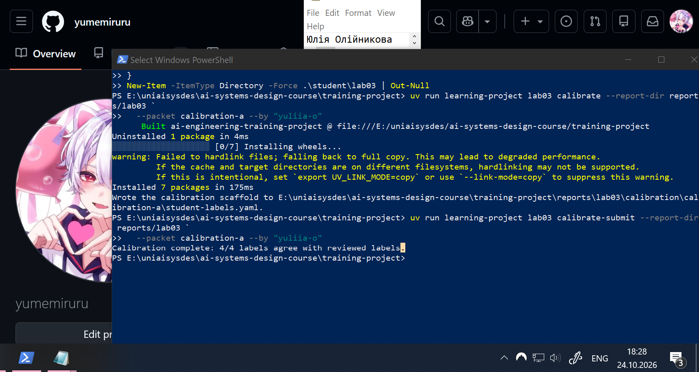
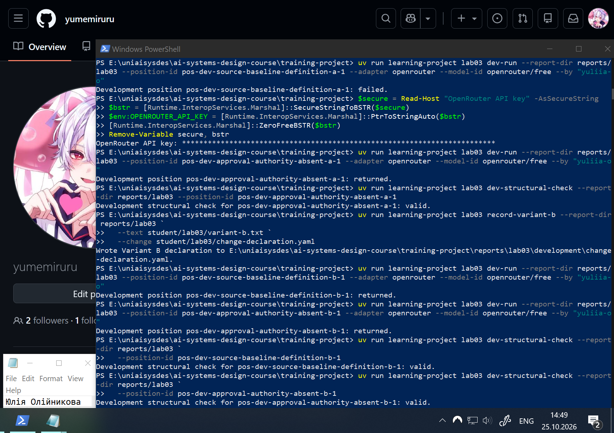
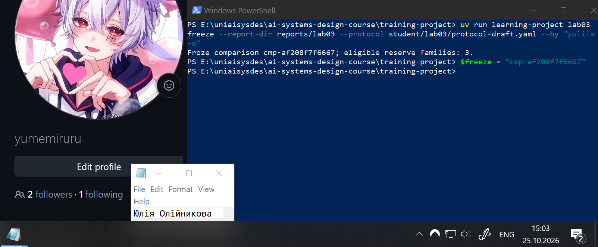
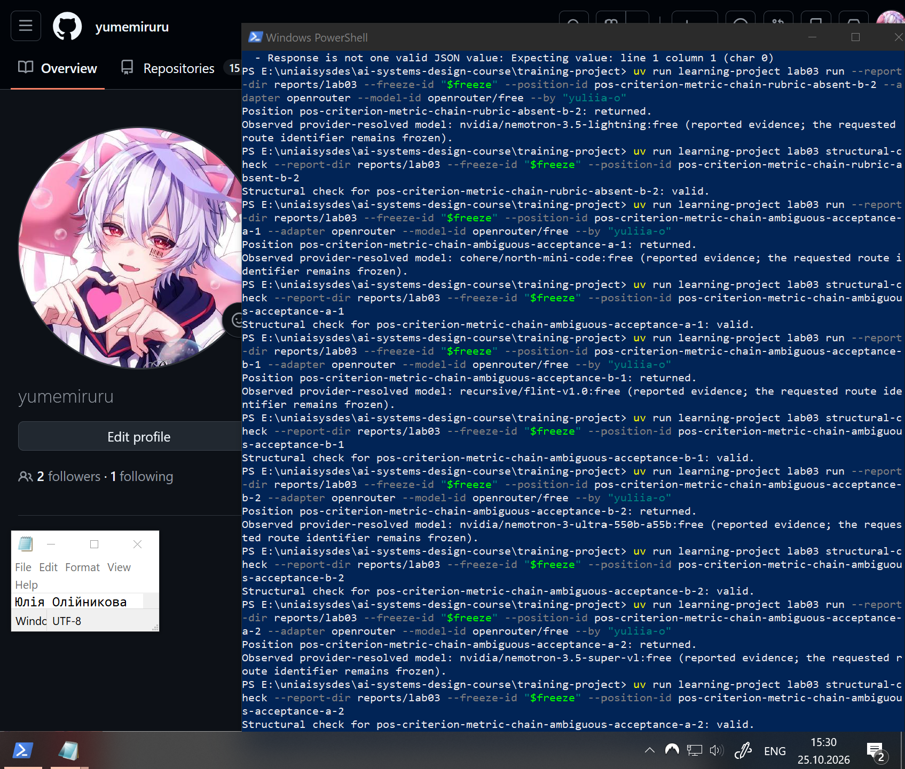
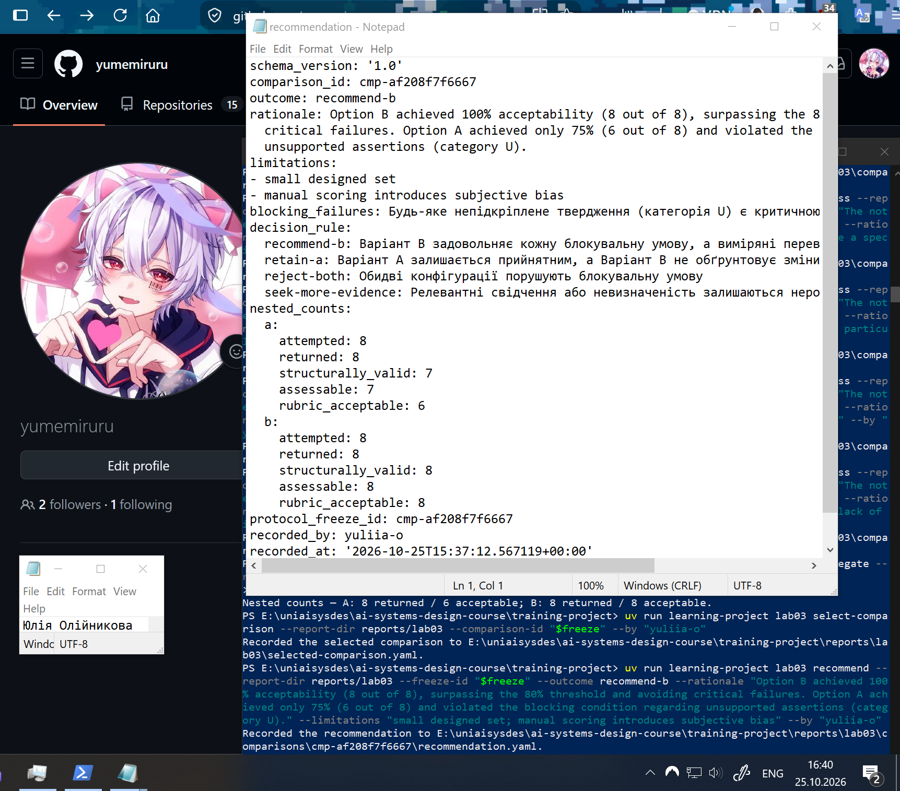
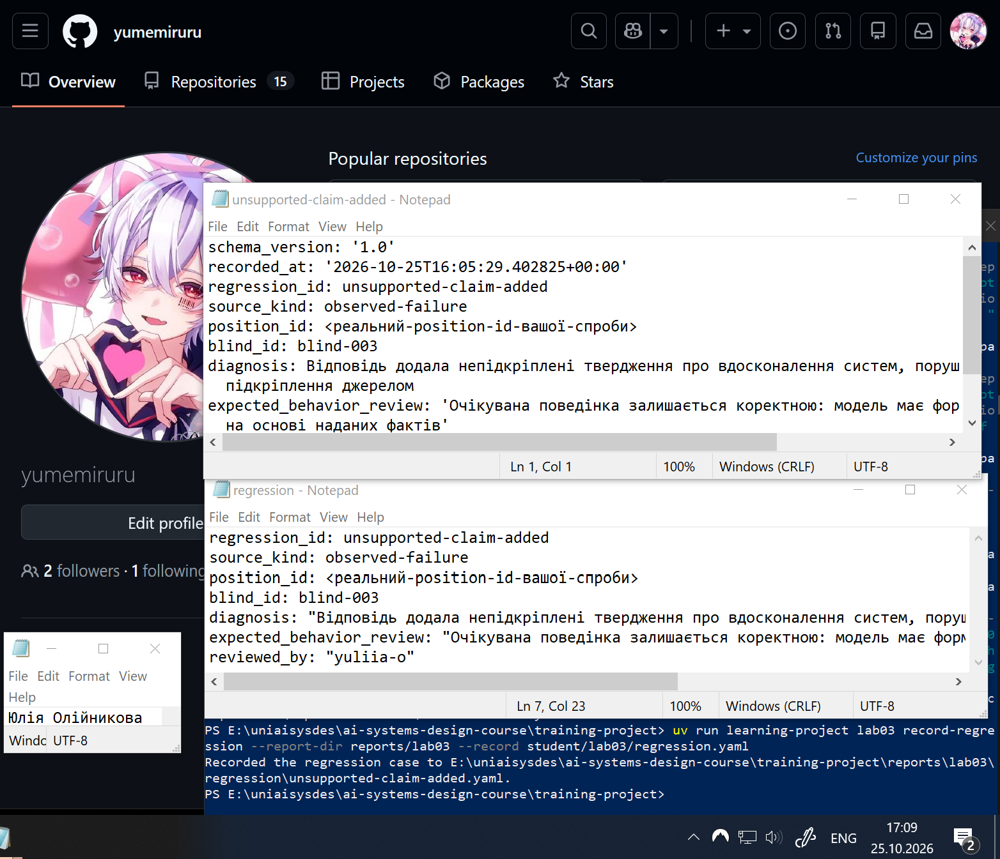

# Лабораторна робота 03

Заповнити кожен розділ українською мовою. Не вилучати заголовки. Відокремлювати спостережені результати від інженерних висновків і рішень. Для статусу `complete` залишити всі наведені відносні шляхи до знімків екрана. Для статусу `honest-partial` вилучити лише посилання на знімки контрольних точок, яких робота не досягла, але залишити посилання на кожний наявний знімок і на `07-final-verification.png`. Не створювати зображення-заповнювачі. На кожному наявному знімку мають бути видимі обліковий запис операційної системи або GitHub і системна дата.

## Ідентифікація подання

- URL форку: https://github.com/yumemiruru/ai-systems-design-course
- Назва особистої гілки: lab03/yuliia-o
- Статус завершення: `complete`

Повний хеш остаточного коміту та результат його перевірки містяться в окремому згенерованому `verification-report.json`. Їх не вписують у цей звіт до коміту, оскільки така зміна створила б інший коміт.

## Мета роботи

Отримати свідчення, потрібні команді інженерів, щоб вирішити, чи має кандидатна конфігурація — варіант B — замінити базову конфігурацію експерименту — варіант A — для оцінюваного використання операції пропозиції поняття з використанням моделі.

## Початковий стан і межа лабораторної роботи 02

Форк репозиторію було успішно синхронізовано з основним репозиторієм upstream. Вхідна перевірка стану після лабораторної роботи 02 пройдена успішно (усі автоматичні тести lab02-inbound завершилися без помилок). Підтверджено, що в межах лабораторної роботи 03 не вносилося жодних змін до прийнятого раніше поняття Structured Output або його аудиторського ланцюга.

## Калібрування оцінювача

Активний пакет калібрування: calibration-a.
Розбіжностей між власними та перевіреними мітками не виявлено: усі чотири призначені категорії точно збіглися з еталонним оцінюванням. Оскільки помилок під час калібрування не було, додаткове уточнення правил абсолютної рубрики не знадобилося.   Проте авторські приклади калібрування готують оцінювача-людину до застосування рубрики і не є свідченням якості генерації моделі.

Рисунок — `01-calibration.png`

## Розробницькі випадки

Для налаштування та тестування Варіантів A та B використано два надані розробницькі випадки, які походять із підготовленого набору авторських фікстур (development fixtures) курсу:
1. Випадок source-baseline-definition: завдання на створення визначення на основі достатнього джерела, що перевіряє здатність моделі зберігати точність фактів.
2. Випадок approval-authority-absent: завдання, у якому необхідні дані відсутні в наданому джерелі, що безпосередньо тестує межу очікуваної поведінки щодо невигадування непідкріплених тверджень.

## Розробницькі запуски й діагноз варіанта A

Було виконано чотири заплановані розробницькі позиції, які не є фінальним відкладеним порівнянням:
Перший запуск Варіанта A (pos-dev-source-baseline-definition-a-1) завершився відмовою (failed).   
Другий запуск Варіанта A (pos-dev-approval-authority-absent-a-1) повернув відповідь, яка успішно пройшла структурну перевірку (valid).   
Перший запуск Варіанта B (pos-dev-source-baseline-definition-b-1) успішно повернув відповідь, структурна перевірка якої є чинною (valid).   
Другий запуск Варіанта B (pos-dev-approval-authority-absent-b-1) також повернув відповідь, що пройшла структурну перевірку (valid).   
Діагноз: На основі теоретичного аналізу базової конфігурації діагностовано, що Варіант А є вразливим до генерації непідкріплених тверджень, оскільки інструкція не вимагає обмежувати відповідь наданим джерелом.

Рисунок — `02-development.png`

## Єдина зміна у варіанті B

До інструкції додано сувору вимогу формувати відповідь виключно на основі наданого джерела, а в разі відсутності запитуваної інформації — прямо про це повідомляти. Вимоги до форматування вихідних даних (повернення одного JSON-об'єкта з двома конкретними полями case_id та proposed_text) залишено абсолютно ідентичними до Варіанта А.
Передбачається, що ця зміна змусить модель констатувати обґрунтовану невизначеність замість того, щоб вигадувати факти, коли джерельних свідчень недостатньо для виконання завдання.
Інші відмінності не було додано для забезпечення чистоти експерименту (ізоляції змінної). Це гарантує, що будь-яка різниця у відсотках прийнятних відповідей під час сліпого оцінювання буде однозначно зумовлена саме доданою вимогою підкріплення, а не зміною структури чи формату.

## Заморожений протокол

Зафіксовано такі параметри протоколу:
- Інженерне рішення: Чи має Варіант B замінити Варіант A для оцінюваного використання операції пропозиції поняття.
- Гіпотеза: Варіант B зменшить кількість непідкріплених тверджень, зберігаючи необхідний зміст і не перевищуючи межі затримки.
- Умови семантичного прийняття: Мінімум 80% прийнятих за рубрикою відповідей серед придатних до оцінювання для кожної конфігурації.
- Блокувальні відмови: Будь-яке непідкріплене твердження (категорія U) є критичною відмовою, що блокує прийняття.
- Правило рішення: Визначається за чотирма можливими результатами (recommend-b, retain-a, reject-both, seek-more-evidence).
- Маршрут: openrouter (модель openrouter/free).
- Часова межа: Вимірюється від початку надіслання запиту до моменту повернення повної відповіді.

Порядок запуску спроб та фіксоване вікно відновлення не визначаються вручну, а призначаються автоматично робочим процесом курсу для забезпечення узгодженості експерименту.

Ідентифікатор заморожування протоколу: cmp-af208f7f6667. Змінити параметри під цим ідентифікатором після фіксації протоколу неможливо.

Рисунок — `03-freeze.png`

## Вибір відкладеної родини та виконання

Автономно вибрано родину випадків criterion-metric-chain-rubric-absent. Стан експозиції: відкладені (небачені раніше) екзаменаційні випадки, які не використовувалися під час розробки. Для виконання було заплановано шістнадцять позицій (по 8 для Варіанта A та Варіанта B).

Усі 16 запланованих позицій успішно повернули відповіді без переривань, глобальних відмов (failed) чи незапущених позицій. Відновлення спроб або зміна маршруту не знадобилися, історія виконання залишилася незмінною. З 16 повернутих відповідей 15 успішно пройшли структурну перевірку, а одна відповідь Варіанта A була визнана структурно невалідною (invalid) через помилку форматування JSON і вилучена з подальшого семантичного оцінювання.

Рисунок — `04-held-out-execution.png`

## Сліпе семантичне оцінювання

Приховування інформації про те, який саме варіант (A чи B) згенерував конкретну відповідь (через використання міток blind-...), гарантувало сліпе оцінювання та ефективно обмежило суб'єктивне упередження оцінювача на користь зміненої конфігурації.

Застосування рубрики базувалося на суворому зіставленні з очікуваною поведінкою:
- Категорії S (підкріплено) та Q (обґрунтована невизначеність) застосовувалися до відповідей, що точно відображали факти з джерела або прямо вказували на їх відсутність.
- Категорія U (непідкріплено) застосовувалася до відповідей, які містили вигадані факти, що фіксувало порушення блокувальної умови.
- Категорії I (неповне), R (відмова) та X (нечитабельне) у цьому пулі не застосовувалися, оскільки відповідні дефекти були відсутні.

Кожна оцінка супроводжувалася точним посиланням на надане джерело та письмовим обґрунтуванням, яке простежувало зв'язок між згенерованим текстом і фактичним змістом джерела.

## Агрегати, зрізи й операційні свідчення

Зафіксовано такі послідовні кількості для Варіанта A: зроблено спроб (attempted) — 8, повернуто (returned) — 8, структурно коректно (structurally_valid) — 7, придатне до оцінювання (assessable) — 7, прийнято за рубрикою (rubric_acceptable) — 6.
Для Варіанта B: зроблено спроб (attempted) — 8, повернуто (returned) — 8, структурно коректно (structurally_valid) — 8, придатне до оцінювання (assessable) — 8, прийнято за рубрикою (rubric_acceptable) — 8.   
Як побічні операційні свідчення відзначено наступне: під час виконання відкладеної родини глобальні відмови та незапущені позиції були відсутні. Для Варіанта A зафіксовано критичний непідтриманий результат, що порушує блокувальну умову (категорія U). Відмінності повторних спроб не спостерігалися, оскільки всі позиції повернули результат з першого разу. Точні дані щодо затримки (latency), використання ресурсів апаратного забезпечення або фінансової вартості запитів є невідомими, оскільки їх збір не передбачався замороженим протоколом.  

## Обмежене рішення щодо конфігурації

Зафіксовано фінальний результат: recommend-b. Це рішення прийнято на основі замороженого правила, оскільки Варіант B досяг 100% прийнятності (8 з 8), що значно перевищує необхідний поріг в 80%, і повністю уникнув блокувальних відмов. Водночас Варіант A не досяг цільових показників та порушив блокувальну умову щодо наявності непідкріплених тверджень (категорія U).   
Це інженерне рішення має обмежений характер: воно лише підтверджує перевагу зміненої конфігурації інструкції (Варіанта B) над базовою. Це рішення не дозволяє розгортання системи у виробничому середовищі або автоматичний запис згенерованого прийнятого знання.

Рисунок — `05-scoring-recommendation.png`

## Регресійний запис

Для створення регресійного запису використано підтверджену спостережену відмову Варіанта A (позиція, що відповідала анонімній мітці blind-003). Діагностована межа полягає у вразливості базової інструкції до галюцинацій: модель додала непідкріплене твердження про вдосконалення систем, якого не було у вихідному тексті. Перевірена очікувана поведінка вимагає, щоб модель зберігала точний зв'язок між сутностями й не додавала інформацію з-поза меж наданого джерела.

Цей відомий регресійний випадок більше не може вважатися свіжим відкладеним свідченням (held-out evidence). Оскільки він уже був експонований, проаналізований людиною та використаний для формулювання діагнозу, надалі він слугуватиме частиною розробницького набору (development set) для тестування майбутніх виправлень і запобігання повторенню цієї помилки.

Рисунок — `06-regression.png`

## Обмеження й статус завершення

Серед невідомих величин залишаються точні показники використання ресурсів, фінансової вартості запитів та продуктивності (затримки) системи за умов великого навантаження. Межі малої спроєктованої вибірки (по 8 позицій для кожного варіанта) не дозволяють екстраполювати ці результати на всі можливі сценарії використання, оскільки вибірка була спеціально сконструйована для тестування конкретної межі очікуваної поведінки. Забороняється стверджувати, що обрана конфігурація повністю унеможливлює галюцинації моделі або що вона готова до масштабного виробничого розгортання без перевірки на ширшому наборі даних.

Оскільки лабораторну роботу виконано повністю, зупинка на проміжних етапах, використання межі відновлення та недосягнуті компетентності відсутні.

## Остаточна перевірка

Базовий коміт курсу фіксує початковий стан репозиторію, який містить лише інструкції, вихідні дані та авторські фікстури до початку виконання експерименту. Остаточний студентський коміт, навпаки, містить усі згенеровані артефакти: варіанти конфігурацій, заморожений протокол, історію виконання, результати сліпого оцінювання, створений регресійний запис та цей заповнений звіт із доказами.

Точний хеш і фінальний результат (passed-complete) з'являться в окремому файлі verification-report.json лише після створення цього остаточного коміту. Студентські свідчення, логи та знімки екрана після здійснення коміту не змінюватимуться.

Рисунок — `07-final-verification.png`

## Висновки

У межах роботи було розроблено та протестовано дві конфігурації промпту для визначення їхньої здатності дотримуватися вимог суворого підкріплення джерелом. Виконано відкладене тестування на 16 екзаменаційних позиціях із подальшим сліпим семантичним оцінюванням результатів. Встановлено, що Варіант B (з вимогою повідомляти про нестачу даних) досяг показника у 100% прийнятних відповідей без жодної критичної відмови. Варіант A (базовий) показав лише 75% прийнятності та припустився критичної відмови (категорія U), додавши непідкріплені твердження.

Зафіксовано рішення щодо рекомендації Варіанта B та створено регресійний запис для дефекту базової конфігурації. На підставі наведених у звіті свідчень мету роботи досягнуто повністю.
