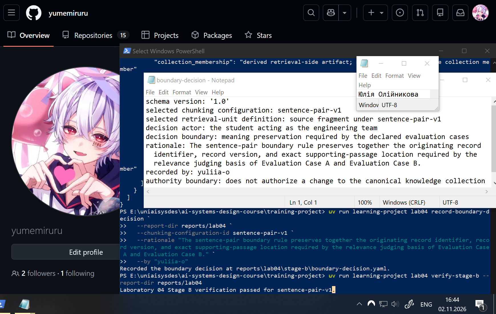
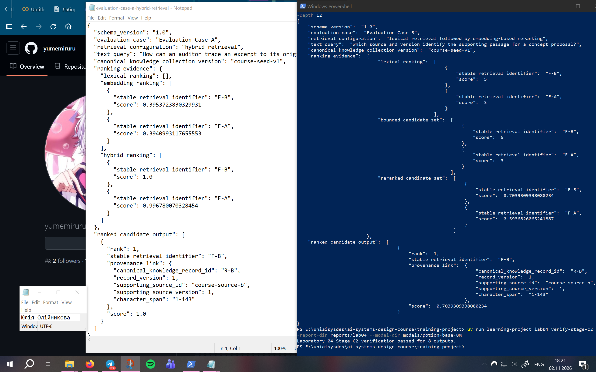
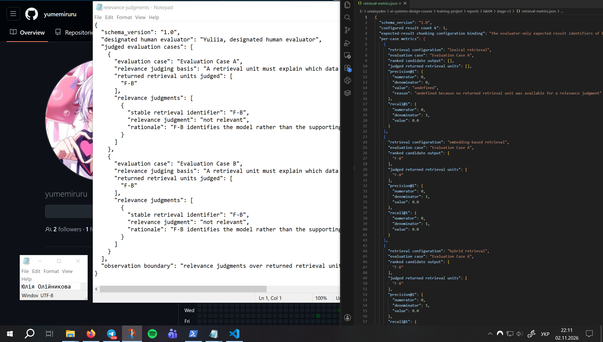

# Лабораторна робота 04

## Ідентифікація подання

- Прізвище та ім’я студента: Олійникова Юлія
- URL форку: https://github.com/yumemiruru/ai-systems-design-course
- Назва особистої гілки: lab04/yuliia-o
- Статус завершення: `complete`

## Мета роботи

Отримати свідчення, потрібні команді інженерів, щоб вирішити, чи має кандидатна конфігурація інформаційного пошуку — пошук на основі ембедингів (embedding-based retrieval) — замінити базову конфігурацію експерименту — лексичний пошук (lexical retrieval) — для оцінюваного використання операції інформаційного пошуку над канонічною колекцією знань course-seed-v1.

## Межа спостереження та початковий стан

Межею спостереження лабораторної роботи визначено виключно операцію інформаційного пошуку. Під час виконання спостерігається лише ранжований кандидатний вихід для заданих текстових запитів. Подальша операція з використанням моделі для генерації пропозиції поняття та загальний результат наскрізного процесу користувача залишаються суворо поза цією межею. Інженерно підтверджено, що операція інформаційного пошуку не має повноважень і не вносить жодних змін до канонічної колекції знань, а отриманий ранжований кандидатний вихід є єдиним спостережуваним результатом цього етапу.

## Вибір конфігурації розбивки на фрагменти та межі одиниці інформаційного пошуку

Для підготовки базових даних до канонічних записів знань R-A та R-B було застосовано дві конфігурації розбивки на фрагменти. Внаслідок застосування правила sentence-pair-v1 утворено дві цілісні одиниці інформаційного пошуку F-A та F-B, тоді як конфігурація fixed-72-v1 розділила текст на дрібніші уривки від F-A-72-1 до F-A-72-4 та від F-B-72-1 до F-B-72-2. За результатами огляду згенерованих файлів виявлено, що правило фіксованої довжини розриває зміст, тоді як конфігурація sentence-pair-v1 зберігає разом ідентифікатор первинного запису, версію запису й точне місце підтвердного уривка, що є критично необхідним для задоволення підстави для судження про релевантність в обох тестових випадках. Тому рішенням щодо конфігурації обрано правило sentence-pair-v1, що дозволило продовжити виконання роботи з коректними межами тексту. У файлі порівняння для утворених одиниць F-A та F-B успішно зафіксовано класифікацію derived retrieval-side artifact; not a canonical knowledge collection member, що підтверджує їхній статус похідних артефактів. Узгодженість цих рішень і спостережень підтверджено успішним проходженням структурної перевірки машинного свідчення етапу.

Рисунок — `01-boundary-selection.png`

## Ембединги одиниць інформаційного пошуку та підготовка векторного індексу

На етапі підготовки векторного індексу створено сумісні ембединги одиниць інформаційного пошуку F-A та F-B з використанням локальної моделі minishlab/potion-base-8M точної ревізії bf8b056651a2c21b8d2565580b8569da283cab23. Зафіксовано, що кожен згенерований ембединг має розмірність 256 координат і належить до простору ембедингів зазначеної моделі з версією представлення course-static-embed-v1. Отримані вектори та асоціації походження зв'язано в один версійований векторний індекс, маніфест якого коректно зафіксував метадані прив’язки для обох одиниць інформаційного пошуку. Під час виконання перевірки прив’язок перед використанням спостережено, що для конфігурації required-course-seed-v1 підготовлений індекс класифікується як припустимий завдяки збігу версій базової колекції. Натомість для конфігурації required-course-seed-v2 індекс очікувано визнано застарілим через невідповідність базової версії колекції. Отримані успішні результати придатної перевірки дозволили безпечно продовжити виконання запитів. На основі цих спостережень підтверджено інженерний висновок про те, що підготовлений векторний індекс є виключно похідним станом для пошуку і не є членом канонічної колекції знань.

Рисунок — `02-embedding-index.png`

## Виконання чотирьох конфігурацій інформаційного пошуку

Під час виконання згенеровано вісім файлів ранжованих кандидатних виходів для двох текстових запитів (Evaluation Case A та Evaluation Case B) за чотирма конфігураціями. У Випадку A лексичний пошук та лексичний пошук із подальшим переранжуванням на основі ембедингів повернули порожній результат; пошук на основі ембедингів повернув фрагмент F-B із балом приблизно 0.395; гібридний пошук також повернув F-B із балом 1.0. У Випадку B всі чотири конфігурації повернули фрагмент F-B: лексичний пошук із балом 5, пошук на основі ембедингів із балом приблизно 0.704, гібридний пошук із балом 2.0 та переранжування з балом приблизно 0.704. Спостережений порожній ранжований кандидатний вихід є валідним результатом пошуку, який свідчить про відсутність кандидатів, що задовольняють критерії ранжування, і кардинально відрізняється від відмови виконання, яка виникає внаслідок технічних помилок процесу. Отримані успішні результати формування виходів дозволили продовжити роботу. Зазначені результати є виключно спостереженнями для двох оголошених випадків оцінювання і не можуть слугувати доказом загальної переваги будь-якого механізму інформаційного пошуку. Узгодженість цих дій підтверджено успішною верифікацією восьми виходів на етапі Stage C2.

Рисунок — `03-retrieval-comparison.png`

## Судження про релевантність

Оголошена підстава для судження про релевантність вимагає, щоб одиниця інформаційного пошуку пояснювала, які дані ідентифікують первинний запис, версію первинного запису та точне місце підтвердного уривка. У результаті виконання пошуку для обох випадків оцінювання єдиною поверненою одиницею виявився фрагмент F-B. Шляхом прямого застосування оголошеної підстави встановлено, що фрагмент F-B ідентифікує модель і версію моделі, а не точне місце підтвердного уривка, тому для цієї одиниці в обох випадках зафіксовано судження not relevant. Інженерно підтверджено, що операція інформаційного пошуку під час виконання жодного разу не отримувала очікуваного результату, призначеного лише для оцінювача. Зафіксовані у файлі суджень оцінки охоплюють точно ті одиниці інформаційного пошуку, які фактично повернули порівнювані конфігурації, що забезпечило повну відповідність вхідних даних для подальшого розрахунку метрик.

## Метрики інформаційного пошуку

Для кількісної оцінки результатів обчислено метрики precision@1 та recall@1 за явними чисельниками й знаменниками для кожного з восьми спостережених виходів.

|**Конфігурація інформаційного пошуку**|**Випадок для оцінювання**|**precision@1 (чисельник/знаменник)**|**recall@1 (чисельник/знаменник)**|
|---|---|---|---|
|lexical retrieval|Evaluation Case A|undefined (0 / 0)|0.0 (0 / 1)|
|embedding-based retrieval|Evaluation Case A|0.0 (0 / 1)|0.0 (0 / 1)|
|hybrid retrieval|Evaluation Case A|0.0 (0 / 1)|0.0 (0 / 1)|
|lexical retrieval followed by embedding-based reranking|Evaluation Case A|undefined (0 / 0)|0.0 (0 / 1)|
|lexical retrieval|Evaluation Case B|0.0 (0 / 1)|0.0 (0 / 1)|
|embedding-based retrieval|Evaluation Case B|0.0 (0 / 1)|0.0 (0 / 1)|
|hybrid retrieval|Evaluation Case B|0.0 (0 / 1)|0.0 (0 / 1)|
|lexical retrieval followed by embedding-based reranking|Evaluation Case B|0.0 (0 / 1)|0.0 (0 / 1)|

Записи precision@1 явно позначено як undefined для лексичного пошуку та конфігурації з переранжуванням у Випадку A. Значення є undefined, а не нулем, оскільки ранжований кандидатний вихід виявився порожнім, отже, жодна повернута одиниця інформаційного пошуку не була доступна для судження про релевантність, що унеможливлює розрахунок знаменника. Агреговані метрики розраховано за правилом підсумовування оцінених повернених одиниць через обидва випадки: для лексичного пошуку та переранжування агрегована точність становить 0.0 (0/1), для векторного та гібридного — 0.0 (0/2), тоді як агрегована повнота для всіх чотирьох конфігурацій становить 0.0 (0/2). Правило агрегації обробляє порожній ранжований кандидатний вихід таким чином, що він не додає жодної одиниці до знаменника точності, але відповідна розглянута релевантна одиниця з еталона все одно збільшує знаменник повноти. Успішне обчислення та проходження фінальної верифікації Stage C3 підтвердило цілісність отриманих машинних свідчень.

Рисунок — `04-relevance-metrics.png`

## Операційні свідчення

Для кожної з чотирьох конфігурацій інформаційного пошуку виміряно п'ять пунктів операційних свідчень із власними межами вимірювання. Вартість побудови підготовленого індексу не вимірювалася повторно, оскільки для всіх конфігурацій було повторно використано один заархівований векторний індекс Stage C1. Затримку запиту виміряно в секундах як середнє значення за три запуски для виконання обох запитів в одному процесі: лексичний пошук — 0.022 с, пошук на основі ембедингів — 0.290 с, гібридний пошук — 0.156 с, лексичний пошук із переранжуванням — 0.157 с. Вартість запиту вимірювалася кількістю операцій кодування: кодування виконувалося для кожного запиту та для перевірки проіндексованих одиниць, при цьому лексичне оцінювання не додавало вартості використання моделі. Споживання ресурсів обмежене повторним використанням локальної моделі в одному процесі без доступу до мережі чи додаткового апаратного забезпечення. Помилки виконання (WorkflowError) під час виконання обох запитів були відсутні для всіх конфігурацій. Підтверджено, що операційні свідчення не є мірою релевантності, і жодне з цих вимірювань не входить до чисельника або знаменника метрик precision@1 чи recall@1.

## Обмежене рішення щодо конфігурації

На основі зібраних машиних свідчень прийнято інженерне рішення залишити лексичну конфігурацію інформаційного пошуку як базову для поточних умов. Обґрунтування базується на тому, що за агрегованим показником recall@1, який становить 0 з 2 для всіх конфігурацій, жоден із механізмів пошуку не повернув розглянуту релевантну одиницю інформаційного пошуку за умови налаштованої кількості результатів k=1. Водночас операційні свідчення демонструють значне збільшення затримки для векторного пошуку (~0.290 с) порівняно з лексичним (~0.022 с). Отже, свідчення не підтверджують доцільність переходу на пошук на основі ембедингів, оскільки він погіршує швидкість без покращення релевантності.   

Рішення має чітку межу застосування: воно обмежується двома оголошеними випадками для оцінювання (Evaluation Case A та B), версією канонічної колекції знань course-seed-v1, межею одиниці інформаційного пошуку sentence-pair-v1, оголошеною підставою для судження про релевантність та налаштуванням k=1. Зафіксовано також межу повноважень: це рішення не встановлює якість кандидатного визначення поняття, сформованого на подальшому етапі з використанням моделі, не гарантує досягнення результату повного робочого процесу користувача та категорично не уповноважує внесення жодних змін до канонічної колекції знань.

Рисунок — `05-operational-decision.png`

## Остаточна верифікація

Виконання команди verify-stage-c3 завершилося успішно з повідомленням про верифікацію восьми записів метрик. Спостережено, що верифікатор незалежно і коректно переобчислює арифметику метрик, беручи за основу зафіксовані вручну судження про релевантність та перевірені на етапі C2 вісім ранжованих кандидатних виходів. Успішне проходження перевірки підтверджує цілісність усіх згенерованих артефактів перед створенням остаточного коміту.

Рисунок — `06-final-verification.png`

## Висновки

У межах лабораторної роботи було обрано конфігурацію розбивки на фрагменти sentence-pair-v1 та підготовлено придатний версійований векторний індекс із сумісними ембедингами. Унаслідок виконання текстових запитів успішно отримано вісім ранжованих кандидатних виходів для чотирьох порівнюваних конфігурацій інформаційного пошуку. Для кожної поверненої одиниці вручну зафіксовано судження про релевантність, на основі яких обчислено метрики інформаційного пошуку та додатково виміряно операційні свідчення. За результатами аналізу цих даних сформульовано й зафіксовано обмежене рішення щодо конфігурації, яке зберігає лексичний пошук через відсутність покращення повноти та зростання затримки у кандидатній векторній конфігурації. На підставі наведених у звіті свідчень мету роботи досягнуто повністю, оскільки зібрано всі необхідні докази для прийняття обґрунтованого інженерного рішення.
